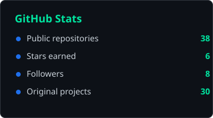

 

---

## 👾 About me

I'm a **Computer Science student at UNIMA AFYA** and hold a **Technical Degree in Computer Science from SESI SENAI**. I build web applications, APIs, enterprise systems and **Artificial Intelligence** solutions, with a focus on agents that use tools (function calling and MCP) to act on real systems.

---

## 🚀 Featured projects

<table>
  <tr>
    <td width="50%" valign="top">
      <h3>💰 <a href="https://github.com/lucazcoding/sistema-controle-gastos">Expense Tracker with AI</a></h3>
      Personal and household expense tracking with an AI assistant that uses tool calling. Backend built with <b>Clean Architecture and DDD</b>, orchestrated with Docker Compose.  
      
      
      
      
      
    </td>
    <td width="50%" valign="top">
      <h3>🔀 <a href="https://github.com/lucazcoding/claude-zen">ClaudeZen Hybrid Router</a></h3>
      Local proxy that routes Claude Code across multiple AI providers, with AUTO, MANUAL and CUSTOM modes, fallback, cooldown, streaming and per-request observability.  
      
      
      
    </td>
  </tr>
  <tr>
    <td width="50%" valign="top">
      <h3>🏭 <a href="https://github.com/lucazcoding/manutech-saas">MANUTECH</a></h3>
      Industrial maintenance management SaaS: from the first request to technical execution, with user roles (attendant, supervisor, technician and admin) and role-based access control (RBAC).  
      
      
      
      
    </td>
    <td width="50%" valign="top">
      <h3>📅 <a href="https://github.com/lucazcoding/agenda-pessoal-ai">Personal Planner with AI</a></h3>
      Planner with a calendar and an assistant that queries, creates, edits and undoes activities on its own through function calling. Next.js, Tailwind and serverless Postgres (Neon).  
      
      
      
    </td>
  </tr>
  <tr>
    <td width="50%" valign="top">
      <h3>🌿 <a href="https://github.com/lucazcoding/plantAI">PlantAI</a></h3>
      <b>Multi-agent</b> system for identifying and analyzing plant diseases, with an IEEE-format paper. Academic Artificial Intelligence project.  
      
      
      
    </td>
    <td width="50%" valign="top">
      <h3>🧠 <a href="https://github.com/lucazcoding/mcp-studies-py">MCP Studies</a></h3>
      Experiments with the Model Context Protocol in Python: servers and tools that let agents interact with systems and APIs.  
      
      
    </td>
  </tr>
  <tr>
    <td width="50%" valign="top">
      <h3>🌳 <a href="https://github.com/lucazcoding/avl-recommendation-system">AVL Tree Recommendation</a></h3>
      Hierarchical product recommendation using AVL trees for fast lookups and automatic category rebalancing.  
      
      
      
    </td>
    <td width="50%" valign="top">
      <h3>🎮 <a href="https://github.com/lucazcoding/godot2d-project">Dead Ember: Survival</a></h3>
      Top-down 2D game in Godot with inventory, NPCs and combat, applying advanced algorithms and data structures.  
      
      
    </td>
  </tr>
</table>

  

---

## 🛠️ Tech stack

**Languages and back-end**

**Front-end**

**Data, cloud and infrastructure**

**AI and agents**

---

## 📈 GitHub activity

  

 

**🐍 A snake eating my contributions**

<picture>
  <source media="(prefers-color-scheme: dark)" srcset="https://raw.githubusercontent.com/lucazcoding/Lucazcoding/output/github-contribution-grid-snake-dark.svg" />
  <source media="(prefers-color-scheme: light)" srcset="https://raw.githubusercontent.com/lucazcoding/Lucazcoding/output/github-contribution-grid-snake.svg" />
  
</picture>

---

## 🎓 Education

| Degree | Institution | Status |
|---|---|---|
| B.Sc. in Computer Science | UNIMA AFYA | In progress |
| Technical Degree in IT | SESI SENAI | Completed |

---

## 🤝 Let's connect

